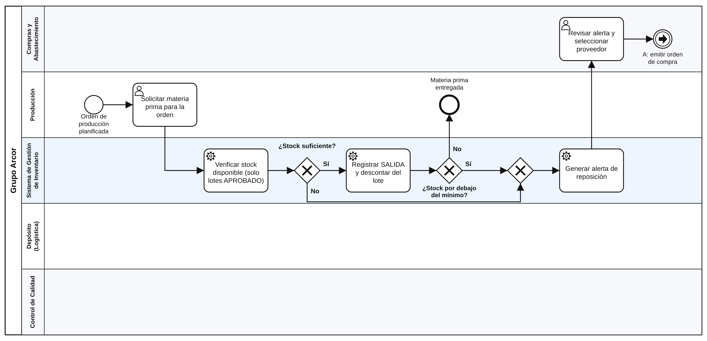
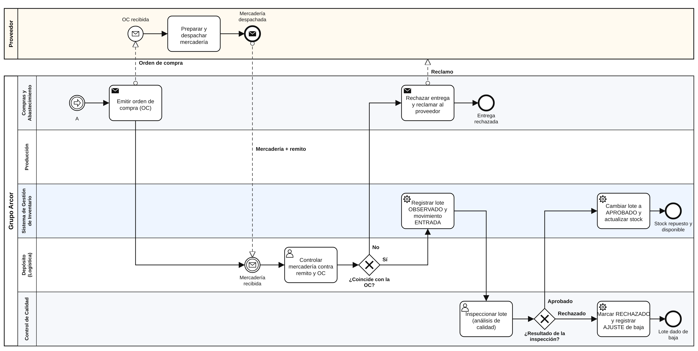

# Proceso BPMN: reposición y recepción de materias primas

**Archivo editable:** [`proceso-reposicion-inventario.bpmn`](proceso-reposicion-inventario.bpmn). Se puede abrir en
<https://demo.bpmn.io> (Open diagram) o en Camunda Modeler.

El diagrama está dividido en dos partes, unidas por el evento de enlace **A**, para que se pueda leer impreso.

## Parte 1 – Detección de la necesidad y alerta

## Parte 2 – Compra, recepción y control de calidad

## Elementos

- **Pools:** *Grupo Arcor* (organización) y *Proveedor* (actor externo). Entre pools solo hay flujos de mensaje (línea de trazos): orden de compra, mercadería con remito y reclamo.
- **Lanes de Grupo Arcor:** Compras y Abastecimiento, Producción, **Sistema de Gestión de Inventario** (tareas automáticas, con ícono de engranaje), Depósito (Logística) y Control de Calidad.
- **Compuertas exclusivas (XOR):**
  1. *¿Stock suficiente?* Si no alcanza, el proceso va directo a la alerta.
  2. *¿Stock por debajo del mínimo?* Aunque se haya entregado la materia prima, se repone antes del faltante.
  3. *¿Coincide con la OC?* Es una excepción: si la entrega no coincide, se rechaza y se reclama al proveedor.
  4. *¿Resultado de la inspección?* Es una excepción: si el lote se rechaza, se da de baja con un AJUSTE.
